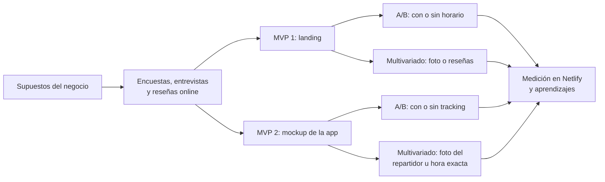

# Leñar, la leña sin vueltas

Validación de una app para que hogares, parrilleros y restaurantes **encuentren, comparen, coordinen y paguen leña** a leñerías, barracas y distribuidores.

> Proyecto del programa Validea Campus, 2025.

**[Ver los 8 prototipos](https://keen-marzipan-d71085.netlify.app)**

## Segmentos

- Consumidores de hogar y parrilleros
- Negocios gastronómicos: restaurantes, parrilladas y pizzerías
- Proveedores: leñerías, barracas y distribuidores

## Del supuesto al experimento



## Estructura del repo

```
lenar-validacion/
├── prototipos/                 sitio estático publicado en Netlify
│   ├── index.html              índice de las 8 variantes
│   ├── landing_a/ … landing_m2/
│   ├── mockup_a/ … mockup_m2/
│   └── assets/                 estilos, navegación entre pantallas e imágenes
├── docs/
│   └── diseno_de_experimentos.md   qué cambia y qué mide cada variante
└── netlify.toml                publica la carpeta prototipos/
```

## Los 8 prototipos

| MVP | Variante | Qué suma |
|---|---|---|
| Landing | A | Control: producto y precio |
| Landing | B | Elección de horario |
| Landing | M1 | Horario y foto |
| Landing | M2 | Horario y reseñas verificadas |
| App | A | Control: pedido confirmado |
| App | B | Tracking del envío |
| App | M1 | Tracking y foto del repartidor |
| App | M2 | Tracking y hora exacta de llegada |

Detalle de cada experimento en [docs/diseno_de_experimentos.md](docs/diseno_de_experimentos.md).

## Cómo correrlo

Es HTML, CSS y JavaScript sin dependencias. Abrí `prototipos/index.html` en el navegador, o levantá un servidor local:

```bash
npx serve prototipos
```

Para publicarlo, conectá el repo a Netlify: `netlify.toml` ya apunta a `prototipos/`.

## Resultados

- Los proveedores aceptaron al principio una **comisión del 1 %**, y subieron **hasta 5 %** después de ver resultados.
- Primeras 24 horas de la landing: buena performance de carga, con un LCP de 1,1 a 1,5 segundos.

## Decisiones de diseño

- **Una variable por vez:** todas las variantes comparten precio, colores y flujo, así la diferencia en conversión se explica por lo que cambia.
- **Prototipos livianos:** HTML estático, sin frameworks, para que carguen rápido y se puedan cambiar en minutos.
- **Medir intención, no promesas:** la conversión es tocar "Continuar" y llegar a la confirmación, una acción concreta en lugar de una respuesta de encuesta.
- **Mismo precio en todo el test:** $350 el pack, para no mezclar sensibilidad al precio con el resto de las variables.

## Stack

HTML · CSS · JavaScript · Netlify · Netlify Analytics · Google Forms · Tests A/B y multivariados

---

**Romina Cor Castro** · [Portafolio](https://rominacor21.github.io) · [LinkedIn](https://www.linkedin.com/in/rominacor/)
